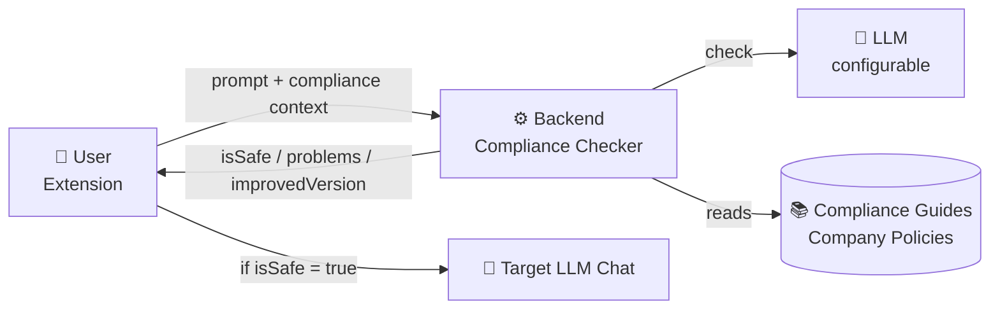
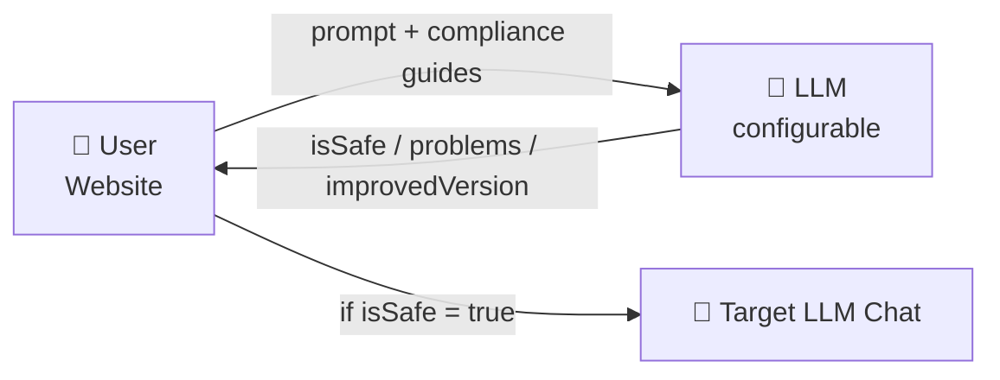
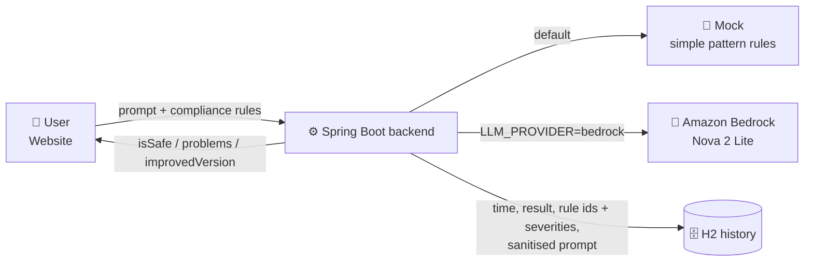

# complianceChecker

## The problem
people post sensitve data in AI chats neglecting their compliance duties.

## Roadmap
**Prio 1**
 - compliance as external website first (minimal viable version)
 - as webbrowser extension

**Prio 2**
- add suggestions cencoring data
- company accounts
  
**Prio 3**
 - token optimisation & prompt engineering.


## Configurable LLM
It can run on a company server, possibly locally, behind a well-defined API.
Avoids potential gdpr problems if servers are self-hosted.

## Infrasturcture - final version



## Infra-structure - first version




The API is defined [here](API.md).

## Current state (MVP)



The backend also serves the website from `frontend/`, so one process is enough.

## Getting started

Requirements: **JDK 21 or newer**. Maven is not needed (the Maven wrapper `./mvnw` downloads it).

```bash
cd backend
./mvnw spring-boot:run
```

Then open **http://localhost:8080/?mock=0**.

- The backend runs in **mock mode** by default: no AWS account, no costs, no data leaves your machine.
- `?mock=0` is needed for now: on `localhost` the website switches to its own browser-only demo mode and would not
  call the backend at all.

Run the tests:

```bash
cd backend
./mvnw test
```

Example prompts and a fictional compliance guide for manual testing are in [`Testdata/`](Testdata).

## Configuration

All settings are environment variables; the defaults work without any setup.

| Variable              | Default                      | Meaning                                                         |
|-----------------------|------------------------------|-----------------------------------------------------------------|
| `LLM_PROVIDER`        | `mock`                       | `mock` = simulated check, `bedrock` = real check via Amazon Bedrock |
| `LLM_MODEL_ID`        | `eu.amazon.nova-2-lite-v1:0` | Bedrock model or inference profile id (only with `bedrock`)     |
| `AWS_REGION`          | `eu-north-1`                 | Bedrock region (only with `bedrock`)                            |
| `HISTORY_DB_URL`      | `jdbc:h2:file:./data/history`| History database; relative to the start directory, i.e. `backend/data/` |
| `HISTORY_DB_USER`     | `sa`                         | Database user                                                   |
| `HISTORY_DB_PASSWORD` | *(empty)*                    | Database password                                               |
| `PORT`                | `8080`                       | HTTP port                                                       |
| `CORS_ALLOWED_ORIGINS`| `chrome-extension://*`       | Origins allowed to call `/api/**` cross-origin (browser extension); comma-separated patterns |

To switch the history to PostgreSQL later, set `HISTORY_DB_URL` (e.g. `jdbc:postgresql://host:5432/compliance`),
user and password; the driver is already included.

### Mock mode

The mock is **not a real compliance check**. It ignores the uploaded compliance rules and only finds a few patterns,
reported with the rule ids of [`Testdata/compliance-guide-musterfinanz.md`](Testdata/compliance-guide-musterfinanz.md)
(like the website's demo mode):

| Pattern                                   | `ruleId` | `severity` | Placeholder       |
|-------------------------------------------|----------|------------|-------------------|
| Sentence with a confidentiality keyword (*confidential*, *internal only*, *vertraulich*, …) | `R-09` | `medium` | `[REMOVED_n]` (whole sentence) |
| IBAN                                      | `R-02`   | `critical` | `[IBAN_n]`        |
| Credit card number (Luhn-checked)         | `R-02`   | `critical` | `[CARD_NUMBER_n]` |
| Email address                             | `R-01`   | `critical` | `[EMAIL_n]`       |
| Phone number                              | `R-01`   | `critical` | `[PHONE_n]`       |

API.md allows no extra response field, so mock results are not marked in the response. The backend logs a warning at
startup instead: `LLM provider 'mock' is active: results are simulated`.

### Real check with Amazon Bedrock

```bash
cd backend
LLM_PROVIDER=bedrock ./mvnw spring-boot:run
```

- Uses **Amazon Nova 2 Lite** through the Bedrock Converse API. `eu-north-1` has no in-region access to this model,
  so the default is the EU inference profile `eu.amazon.nova-2-lite-v1:0`, which keeps requests inside EU regions.
- Model access must be enabled for your AWS account in the Bedrock console.
- **Every check is a paid AWS call.**
- Credentials come from the standard AWS chain: `aws sso login` / an AWS profile locally, an IAM role on AWS.
  **Never put AWS keys into code, `application.yml` or the repository.**
- The model reports `ruleId` and `severity` from the uploaded compliance rules. Unknown severities count as `critical`,
  a `location` that is not found verbatim in the prompt becomes `""`, and an "unsafe" verdict without a blocking
  problem gets an `UNSPECIFIED` / `critical` problem.
- If Bedrock fails, times out (50 s) or returns an unusable answer, the API returns `502` and the prompt is **not**
  approved.

## Endpoints

| Method | Path           | Purpose                                     |
|--------|----------------|---------------------------------------------|
| `POST` | `/api/check`   | Check a prompt against compliance rules     |
| `GET`  | `/api/history` | The latest 100 checks, newest first         |

`POST /api/check` follows [API.md](API.md) exactly. The rest below is backend-only and not (yet) part of API.md.

### `GET /api/history`

```json
[
  {
    "id": 2,
    "createdAt": "2026-11-21T10:00:00Z",
    "isSafe": false,
    "findings": [{ "ruleId": "R-01", "severity": "critical" }],
    "improvedVersion": "Reply to [EMAIL_1] about her loan."
  }
]
```

### Error responses

```json
{
  "error": "INVALID_REQUEST",
  "message": "The request is invalid. See fieldErrors.",
  "fieldErrors": { "prompt": "must not be empty" },
  "requestId": "6f1c..."
}
```

| Status | `error`                  | When                                       |
|--------|--------------------------|--------------------------------------------|
| 400    | `INVALID_REQUEST`        | empty/missing/too long field, invalid JSON |
| 405    | `METHOD_NOT_ALLOWED`     | wrong HTTP method                          |
| 415    | `UNSUPPORTED_MEDIA_TYPE` | `Content-Type` is not `application/json`   |
| 502    | `LLM_UNAVAILABLE`        | the LLM could not be reached or failed     |
| 500    | `INTERNAL_ERROR`         | anything else                              |

## Privacy

- The **original prompt is never stored**, neither in the database nor in logs. Logs contain only metadata
  (lengths, result, rule ids and severities, model, duration).
- `problems[].location` (the matched passage, required by API.md) is only returned to the user who sent the prompt.
  It is **never logged or stored**.
- The history stores only: time, `isSafe`, rule ids with severities and the sanitised prompt. Rule ids that do not
  look like ids (e.g. free text from the LLM) are stored as `UNSPECIFIED`. The sanitised prompt is only stored if it
  differs from the original, contains none of the matched passages and the pattern scanner finds no sensitive data
  left in it; otherwise it is stored as `""`. Compliance rules, messages and matched text are never stored.
- Error responses contain fixed texts only, never parts of the request.

## Backend structure

```
backend/src/main/java/com/compliancechecker/
├── controller/  REST endpoints and error handling
├── service/     ComplianceService (check + history), SensitiveDataScanner (pattern rules)
├── llm/         LlmClient with MockLlmClient (default) and BedrockLlmClient
├── history/     HistoryEntry, HistoryRepository, HistoryService (H2 via Spring Data JPA)
├── model/       request/response records
└── config/      Bedrock client (only created with LLM_PROVIDER=bedrock)
```
