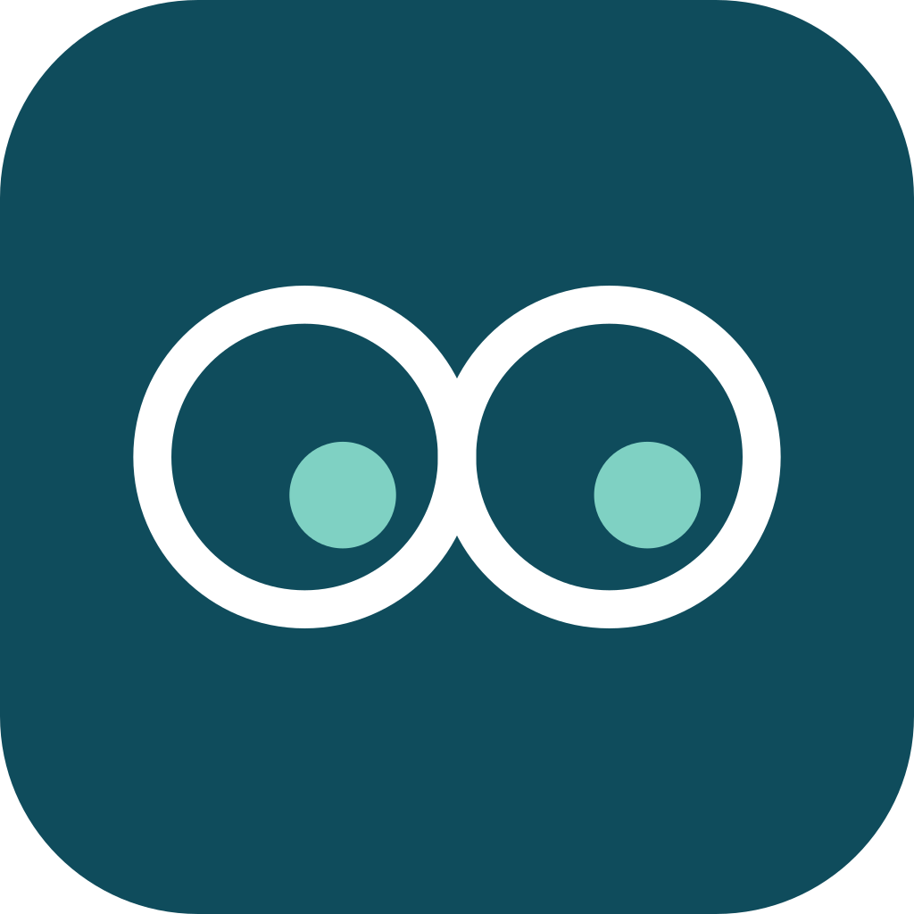
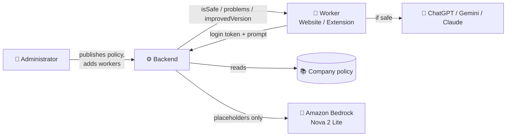

# Four Eyes

A compliance gate for financial service providers. Prompts are checked against the company's compliance policy
before they reach an AI chat; sensitive data is blocked and a sanitised version is suggested.



## Quickstart

Requires JDK 21+.

```bash
cd backend
ADMIN_CODE=choose-a-code AWS_PROFILE=<profile> ./mvnw spring-boot:run   # real check
LLM_PROVIDER=mock ./mvnw spring-boot:run                                 # offline demo
```

Open http://localhost:8080, log in as `admin`, publish `Testdata/compliance-guide-musterfinanz.md`, add a worker.
Full walkthrough including the extension: [docs/setup.md](docs/setup.md).

## Docs

| File                                       | Content                                              |
|--------------------------------------------|------------------------------------------------------|
| [docs/setup.md](docs/setup.md)             | Run backend, website and extension locally; troubleshooting |
| [docs/backend.md](docs/backend.md)         | Configuration, LLM providers, history, code structure |
| [docs/extension.md](docs/extension.md)     | How the Chrome extension works and is built          |
| [docs/privacy.md](docs/privacy.md)         | What is stored and sent; known demo limitations      |
| [API.md](API.md)                           | Client/server contract                               |
| [CONTRIBUTING.md](CONTRIBUTING.md)         | Branches, commits, rules                             |
| [Testdata/](Testdata)                      | Fictional policy and test prompts                    |

## Roadmap

- [x] Website (Stage 1) and Chrome extension (Stage 2)
- [x] Sanitised suggestions, company accounts
- [ ] Single sign-on instead of the demo login
- [ ] Deployment on AWS
- [ ] Token optimisation and prompt engineering
