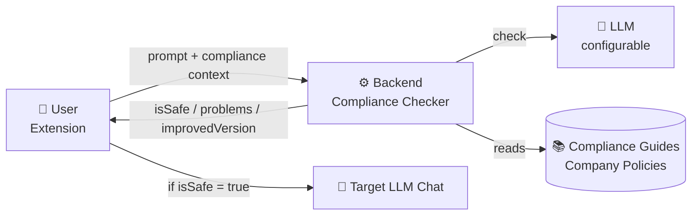
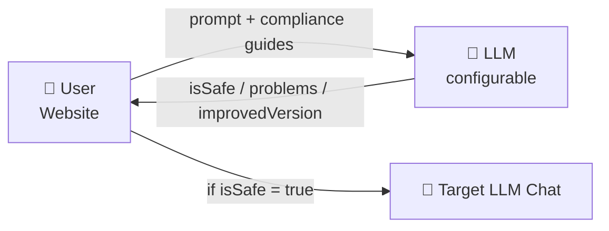

# complianceChecker

## The problem
people post sensitve data in AI chats neglecting their compliance duties.

## Roadmap
**Prio 1**
 - compliance as external website first (minimal viable version)
 - as webbrowser extension

**Prio 2**
- add suggestions cencoring data
- company accounts
  
**Prio 3**
 - token optimisation & prompt engineering.

## Configurable LLM
It can run on a company server, possibly locally, behind a well-defined API.
Avoids potential gdpr problems if servers are self-hosted.

## Infrasturcture - final version

## Infra-structure - first version

The API is defined [here](API.md).
