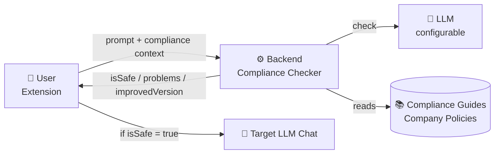
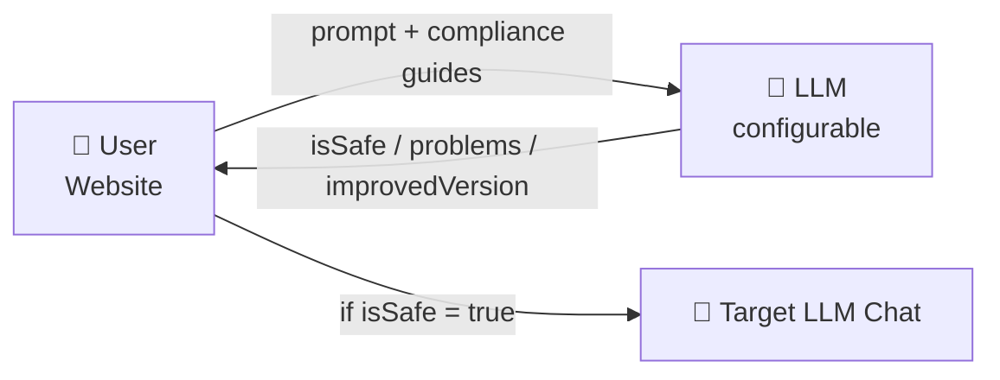
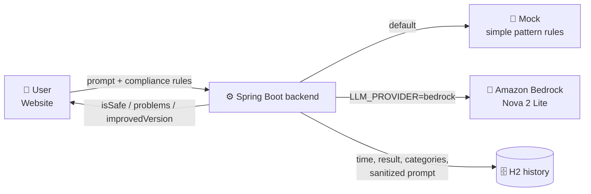

# complianceChecker

## The problem
people post sensitve data in AI chats neglecting their compliance duties.

## Roadmap
**Prio 1**
 - compliance as external website first (minimal viable version)
 - as webbrowser extension

**Prio 2**
- add suggestions cencoring data
- company accounts
  
**Prio 3**
 - token optimisation & prompt engineering.


## Configurable LLM
It can run on a company server, possibly locally, behind a well-defined API.
Avoids potential gdpr problems if servers are self-hosted.

## Infrasturcture - final version



## Infra-structure - first version




The API is defined [here](API.md).

## Current state (MVP)



The backend also serves the website from `frontend/`, so one process is enough.

## Getting started

Requirements: **JDK 21 or newer**. Maven is not needed (the Maven wrapper `./mvnw` downloads it).

```bash
cd backend
./mvnw spring-boot:run
```

Then open **http://localhost:8080/?mock=0**.

- The backend runs in **mock mode** by default: no AWS account, no costs, no data leaves your machine.
- `?mock=0` is needed for now: on `localhost` the website switches to its own browser-only demo mode and would not
  call the backend at all.

Run the tests:

```bash
cd backend
./mvnw test
```

Example prompts and a fictional compliance guide for manual testing are in [`Testdata/`](Testdata).

## Configuration

All settings are environment variables; the defaults work without any setup.

| Variable              | Default                      | Meaning                                                         |
|-----------------------|------------------------------|-----------------------------------------------------------------|
| `LLM_PROVIDER`        | `mock`                       | `mock` = simulated check, `bedrock` = real check via Amazon Bedrock |
| `LLM_MODEL_ID`        | `eu.amazon.nova-2-lite-v1:0` | Bedrock model or inference profile id (only with `bedrock`)     |
| `AWS_REGION`          | `eu-north-1`                 | Bedrock region (only with `bedrock`)                            |
| `HISTORY_DB_URL`      | `jdbc:h2:file:./data/history`| History database; relative to the start directory, i.e. `backend/data/` |
| `HISTORY_DB_USER`     | `sa`                         | Database user                                                   |
| `HISTORY_DB_PASSWORD` | *(empty)*                    | Database password                                               |
| `PORT`                | `8080`                       | HTTP port                                                       |

To switch the history to PostgreSQL later, set `HISTORY_DB_URL` (e.g. `jdbc:postgresql://host:5432/compliance`),
user and password; the driver is already included.

### Mock mode

The mock is **not a real compliance check**. It ignores the uploaded compliance rules and only finds a few patterns:
email addresses, phone numbers, credit card numbers (Luhn-checked), IBANs and confidentiality keywords such as
*confidential* or *vertraulich*. Every result is marked with `"simulated": true`.

### Real check with Amazon Bedrock

```bash
cd backend
LLM_PROVIDER=bedrock ./mvnw spring-boot:run
```

- Uses **Amazon Nova 2 Lite** through the Bedrock Converse API. `eu-north-1` has no in-region access to this model,
  so the default is the EU inference profile `eu.amazon.nova-2-lite-v1:0`, which keeps requests inside EU regions.
- Model access must be enabled for your AWS account in the Bedrock console.
- **Every check is a paid AWS call.**
- Credentials come from the standard AWS chain: `aws sso login` / an AWS profile locally, an IAM role on AWS.
  **Never put AWS keys into code, `application.yml` or the repository.**
- If Bedrock fails or returns an unusable answer, the API returns `502` and the prompt is **not** approved.

## Endpoints

| Method | Path           | Purpose                                     |
|--------|----------------|---------------------------------------------|
| `POST` | `/api/check`   | Check a prompt against compliance rules     |
| `GET`  | `/api/history` | The latest 100 checks, newest first         |

Payloads, limits and error format: [API.md](API.md).

## Privacy

- The **original prompt is never stored**, neither in the database nor in logs. Logs contain only metadata
  (lengths, result, categories, model, duration).
- The history stores only: time, `isSafe`, problem categories and the sanitized prompt. The sanitized prompt is only
  stored if it differs from the original and the pattern scanner finds no sensitive data left in it; otherwise it is
  stored as `null`. Compliance rules and matched text are never stored.
- Error responses contain fixed texts only, never parts of the request.

## Backend structure

```
backend/src/main/java/com/compliancechecker/
├── controller/  REST endpoints and error handling
├── service/     ComplianceService (check + history), SensitiveDataScanner (pattern rules)
├── llm/         LlmClient with MockLlmClient (default) and BedrockLlmClient
├── history/     HistoryEntry, HistoryRepository, HistoryService (H2 via Spring Data JPA)
├── model/       request/response records
└── config/      Bedrock client (only created with LLM_PROVIDER=bedrock)
```
