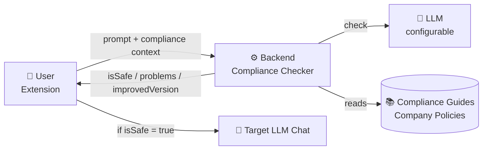
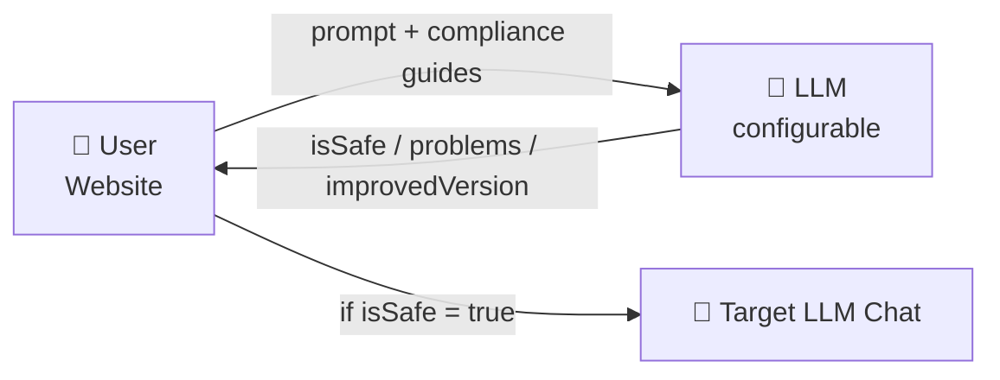
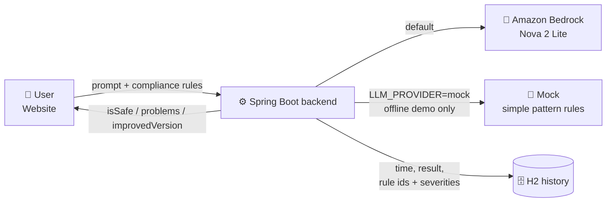

# complianceChecker

## The problem
people post sensitve data in AI chats neglecting their compliance duties.

## Roadmap
**Prio 1**
 - compliance as external website first (minimal viable version)
 - as webbrowser extension

**Prio 2**
- add suggestions cencoring data
- company accounts
  
**Prio 3**
 - token optimisation & prompt engineering.


## Configurable LLM
It can run on a company server, possibly locally, behind a well-defined API.
Avoids potential gdpr problems if servers are self-hosted.

## Infrasturcture - final version



## Infra-structure - first version




The API is defined [here](API.md).

## Current state (MVP)



The backend also serves the website from `frontend/`, so one process is enough.

## Getting started

Requirements: **JDK 21 or newer**. Maven is not needed (the Maven wrapper `./mvnw` downloads it).

**Real check with Amazon Bedrock (default):**

```bash
cd backend
AWS_PROFILE=hackathon ./mvnw spring-boot:run
```

Then open **http://localhost:8080** (no URL parameter needed). The profile `hackathon` is only an example: any
profile or credentials of the AWS default chain work, see [Real check with Amazon Bedrock](#real-check-with-amazon-bedrock).

**Offline demo without AWS (explicit, simulated results):**

```bash
cd backend
LLM_PROVIDER=mock ./mvnw spring-boot:run
```

Then open **http://localhost:8080**. The mock is never used silently: without `LLM_PROVIDER=mock` the backend always
calls Bedrock, and if that fails the check fails with a clear message. For a demo without any backend, open the page
with `?mock=1` (browser-only demo mode, a "Demo" badge is shown).

Run the tests:

```bash
cd backend
./mvnw test
```

Example prompts and a fictional compliance guide for manual testing are in [`Testdata/`](Testdata).

## Configuration

All settings are environment variables; the defaults work without any setup.

| Variable              | Default                      | Meaning                                                         |
|-----------------------|------------------------------|-----------------------------------------------------------------|
| `LLM_PROVIDER`        | `bedrock`                    | `bedrock` = real check via Amazon Bedrock, `mock` = offline demo with pattern rules (explicit only) |
| `AWS_PROFILE`         | *(AWS default chain)*        | AWS profile to use, e.g. `hackathon` (only with `bedrock`)      |
| `LLM_MODEL_ID`        | `eu.amazon.nova-2-lite-v1:0` | Bedrock model or inference profile id (only with `bedrock`)     |
| `AWS_REGION`          | `eu-north-1`                 | Bedrock region (only with `bedrock`)                            |
| `HISTORY_DB_URL`      | `jdbc:h2:file:./data/history`| History database; relative to the start directory, i.e. `backend/data/` |
| `HISTORY_DB_USER`     | `sa`                         | Database user                                                   |
| `HISTORY_DB_PASSWORD` | *(empty)*                    | Database password                                               |
| `PORT`                | `8080`                       | HTTP port                                                       |
| `CORS_ALLOWED_ORIGINS`| `chrome-extension://*`       | Origins allowed to call `/api/**` cross-origin (browser extension); comma-separated patterns |

To switch the history to PostgreSQL later, set `HISTORY_DB_URL` (e.g. `jdbc:postgresql://host:5432/compliance`),
user and password; the driver is already included.

### Mock mode (offline demo only)

Only active with `LLM_PROVIDER=mock`, never as a fallback. The mock is **not a real compliance check**. It ignores the uploaded compliance rules and only finds a few patterns,
reported with the rule ids of [`Testdata/compliance-guide-musterfinanz.md`](Testdata/compliance-guide-musterfinanz.md)
(like the website's demo mode):

| Pattern                                                              | `ruleId` | `severity` | Placeholder |
|----------------------------------------------------------------------|----------|------------|-------------|
| Sentence with an insider keyword (*profit warning*, *takeover bid*, *Gewinnwarnung*, …) | `R-04` | `critical` | `[REMOVED_n]` (whole sentence) |
| Sentence with health data (*sick leave*, *diagnosis*, *depression*, *pregnant*, …) | `R-03` | `critical` | `[REMOVED_n]` (whole sentence) |
| Sentence with a confidentiality keyword (*confidential*, *internal only*, *vertraulich*, …) | `R-09` | `medium` | `[REMOVED_n]` (whole sentence) |
| Password / token / API key after `=` or `:`; internal IPv4 address   | `R-05`   | `critical` | `[SECRET_n]`, `[IP_ADDRESS_n]` |
| IBAN; credit card number (Luhn-checked)                              | `R-02`   | `critical` | `[IBAN_n]`, `[CARD_NUMBER_n]` |
| Email; phone; name after *Mr/Mrs/Ms/Herr/Frau*; date of birth after *born/geb.*; street + house number | `R-01` | `critical` | `[EMAIL_n]`, `[PHONE_n]`, `[NAME_n]`, `[DATE_OF_BIRTH_n]`, `[ADDRESS_n]` |
| Company name with a legal form (*GmbH*, *AG*, *SE*, *Ltd*, …)        | `R-08`   | `medium`   | `[COMPANY_n]` |

With these rules the mock handles all 9 prompts in [`Testdata/test-prompts.md`](Testdata/test-prompts.md) as expected
(checked by `TestdataPromptsTest`). It still misses anything without such a pattern, e.g. a name without a form of
address or a company without a legal form.

API.md allows no extra response field, so mock results are not marked in the response. The backend logs a warning at
startup instead: `LLM provider 'mock' is active: results are simulated`.

### Real check with Amazon Bedrock

```bash
cd backend
AWS_PROFILE=hackathon ./mvnw spring-boot:run     # LLM_PROVIDER=bedrock is the default
```

- Uses **Amazon Nova 2 Lite** through the Bedrock Converse API. `eu-north-1` has no in-region access to this model,
  so the default is the EU inference profile `eu.amazon.nova-2-lite-v1:0`, which keeps requests inside EU regions
  (per the AWS model card; whether your account may use it is only known after the first call).
- Model access must be enabled for your AWS account in the Bedrock console. The IAM user or role typically needs
  `bedrock:InvokeModel` on the inference profile and on the model in the EU regions the profile routes to.
- **Every check is a paid AWS call.**
- Credentials come from the standard AWS chain (`AWS_PROFILE`, environment variables, `aws sso login`, an IAM role on
  AWS). **Never put AWS keys into code, `application.yml` or the repository.**
- **The uploaded compliance rules are the basis of the check.** The model reports `ruleId` and `severity` from them.
- **Data minimisation:** before anything is sent, the local rules (see the mock's table) replace everything they find,
  e.g. IBANs, emails or names after a form of address, by placeholders such as `[IBAN_1]`. Bedrock only sees the
  placeholders and checks the rest; the local findings are added to the model's findings.
- Unknown severities count as `critical`, a `location` that is not found verbatim in the prompt becomes `""`, and an
  "unsafe" verdict without a blocking problem gets an `UNSPECIFIED` / `critical` problem. If the model does not call
  the result tool it is asked once more.
- **No false approval, no silent mock:** every AWS error (and a model that stays unusable) returns `502`, the prompt is
  **not** approved and nothing is stored. The error message says what to fix, chosen by the type of error and never
  taken from AWS (it could echo the request):

| Cause                                   | Message (short)                                   |
|-----------------------------------------|---------------------------------------------------|
| no or expired AWS credentials           | AWS credentials are missing or expired …          |
| access denied                           | Access to the AI model was denied …               |
| wrong model id / region                 | The configured AI model is not available …        |
| rate limit / model loading              | The AI service is busy …                          |
| timeout (50 s)                          | The AI model did not answer in time …             |
| network                                 | The AI service could not be reached …             |

## Endpoints

| Method | Path           | Purpose                                     |
|--------|----------------|---------------------------------------------|
| `POST` | `/api/check`   | Check a prompt against compliance rules     |
| `GET`  | `/api/history` | The latest 100 checks, newest first         |

`POST /api/check` follows [API.md](API.md) exactly. The rest below is backend-only and not (yet) part of API.md.

### `GET /api/history`

```json
[
  {
    "id": 2,
    "createdAt": "2026-11-21T10:00:00Z",
    "isSafe": false,
    "findings": [{ "ruleId": "R-01", "severity": "critical" }]
  }
]
```

### Error responses

```json
{
  "error": "INVALID_REQUEST",
  "message": "The request is invalid. See fieldErrors.",
  "fieldErrors": { "prompt": "must not be empty" },
  "requestId": "6f1c..."
}
```

| Status | `error`                  | When                                       |
|--------|--------------------------|--------------------------------------------|
| 400    | `INVALID_REQUEST`        | empty/missing/too long field, invalid JSON |
| 405    | `METHOD_NOT_ALLOWED`     | wrong HTTP method                          |
| 415    | `UNSUPPORTED_MEDIA_TYPE` | `Content-Type` is not `application/json`   |
| 502    | `LLM_UNAVAILABLE`        | the LLM could not be reached or failed     |
| 500    | `INTERNAL_ERROR`         | anything else                              |

## Privacy

- The **original prompt is never stored**, neither in the database nor in logs. Logs contain only metadata
  (lengths, result, rule ids and severities, model, duration, and for AWS errors the type of the error).
- **Bedrock only receives placeholders** for everything the local rules find (see above), not the values themselves.
  Names without a form of address cannot be found by patterns and are sent: the model is told to check for them.
- `problems[].location` (the matched passage, required by API.md) is only returned to the user who sent the prompt.
  It is **never logged or stored**.
- **The history stores no text at all**, neither the prompt nor the sanitised version (a pattern scanner cannot know
  every name in it): only time, `isSafe` and the rule ids with severities. Rule ids that do not look like ids (e.g.
  free text from the LLM) are stored as `UNSPECIFIED`. The table is `compliance_check`; older local databases may still
  contain a `check_history` table with sanitised prompts of earlier versions. Delete `backend/data/` to get rid of it.
- Error responses contain fixed texts only, never parts of the request or of the AWS error.

## Backend structure

```
backend/src/main/java/com/compliancechecker/
├── controller/  REST endpoints and error handling
├── service/     ComplianceService (check + history), SensitiveDataScanner (pattern rules)
├── llm/         LlmClient with BedrockLlmClient (default) and MockLlmClient (LLM_PROVIDER=mock only)
├── history/     HistoryEntry, HistoryRepository, HistoryService (H2 via Spring Data JPA)
├── model/       request/response records
└── config/      Bedrock client (created unless LLM_PROVIDER=mock), CORS
```

## Chrome extension (Stage 2, in progress)

Lives in [`extension/`](extension/), built with [WXT](https://wxt.dev) (Manifest V3). It reuses the website's
contract code from `frontend/js/shared/` via the `@shared` alias, so that folder must stay free of `window`/DOM access.

```bash
cd extension
npm install
npm run dev     # opens Chrome with the extension loaded and hot reload
npm run build   # → extension/.output/chrome-mv3
```

To load a build manually: `chrome://extensions` → Developer mode → *Load unpacked* → `extension/.output/chrome-mv3`.

On `chatgpt.com` the extension holds back every send (Enter or the send button), checks the prompt against the
uploaded rules and only sends it if it is compliant. Blocked prompts show the problems and, if available, a
suggested version. If the check cannot run, nothing is sent.

**Backend:** the endpoint is defined once for website and extension in `frontend/js/shared/config.js`.
The website is served by the backend and always calls `/api/check` on its own origin. The extension is not, so it
uses the absolute `BACKEND_ORIGIN` (default `http://localhost:8080`, the local backend; set the AWS URL there later)
and derives its host permission from it. Start the backend first (`cd backend && ./mvnw spring-boot:run`) and rebuild
the extension after changing the value. With `BACKEND_ORIGIN = ""` the extension runs in demo mode (local mock check,
nothing leaves the browser). If the backend is not reachable, nothing is sent. The backend also allows the extension
via `CORS_ALLOWED_ORIGINS`.

**Try it:** click the toolbar icon → upload a rules file (e.g. `Testdata/compliance-guide-musterfinanz.md`) → on
chatgpt.com send `Pay DE89 3704 0044 0532 0130 00` (blocked, suggests `[IBAN_1]`) and `Hello` (sent normally).
