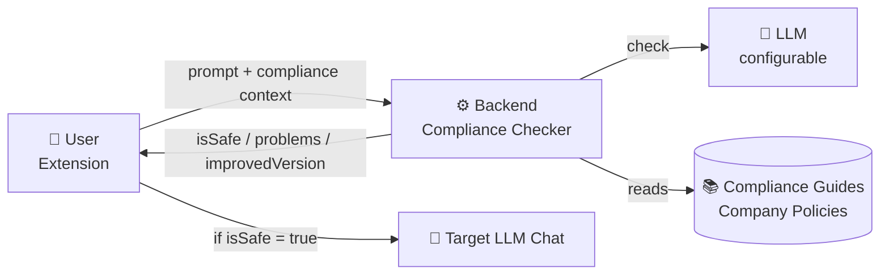
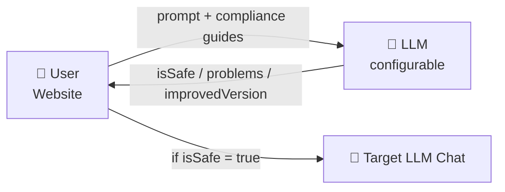

# complianceChecker

## The problem
people post sensitve data in AI chats neglecting their compliance duties.

## Roadmap
**Prio 1**
 - compliance as external website first (minimal viable version)
 - as webbrowser extension

**Prio 2**
- add suggestions cencoring data
- company accounts
  
**Prio 3**
 - token optimisation & prompt engineering.


## Configurable LLM
It can run on a company server, possibly locally, behind a well-defined API.
Avoids potential gdpr problems if servers are self-hosted.

## Infrasturcture - final version



## Infra-structure - first version




The API is defined [here](API.md).

## Chrome extension (Stage 2, in progress)

Lives in [`extension/`](extension/), built with [WXT](https://wxt.dev) (Manifest V3). It reuses the website's
contract code from `frontend/js/shared/` via the `@shared` alias, so that folder must stay free of `window`/DOM access.

```bash
cd extension
npm install
npm run dev     # opens Chrome with the extension loaded and hot reload
npm run build   # → extension/.output/chrome-mv3
```

To load a build manually: `chrome://extensions` → Developer mode → *Load unpacked* → `extension/.output/chrome-mv3`.
